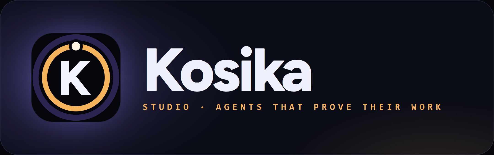
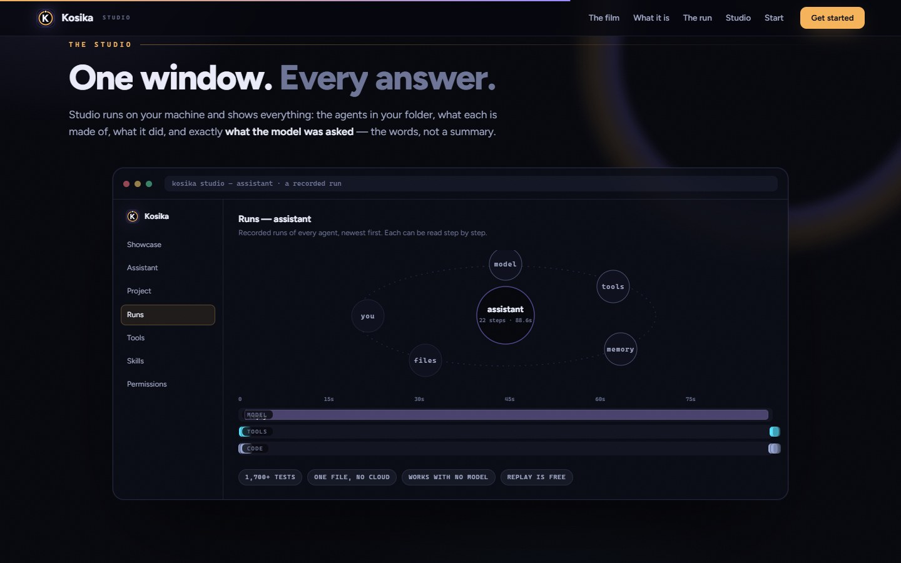
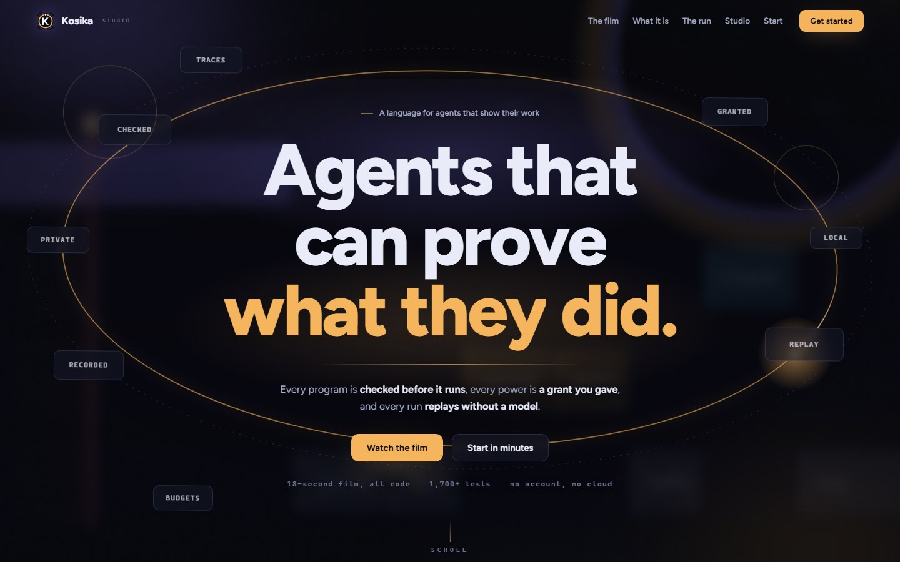
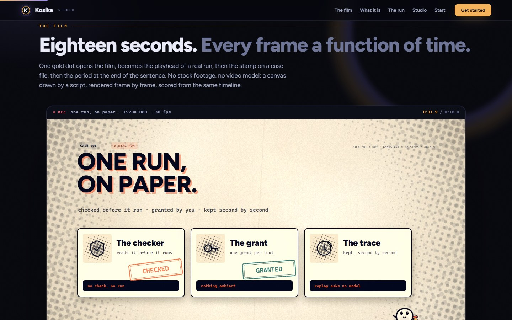
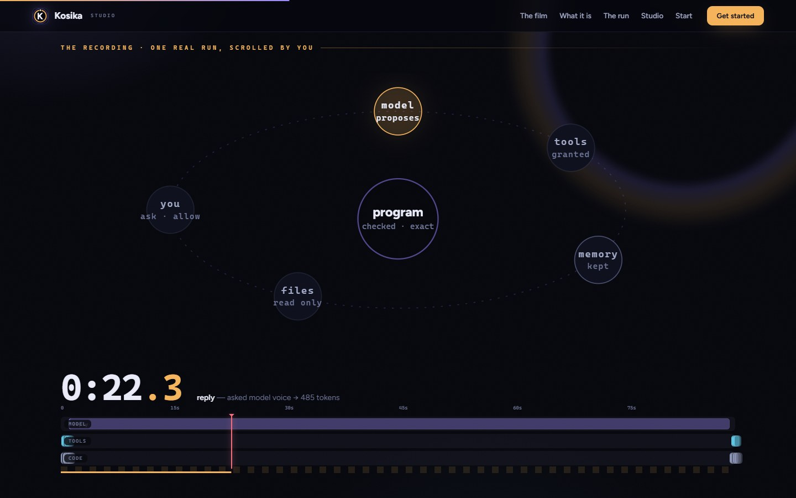
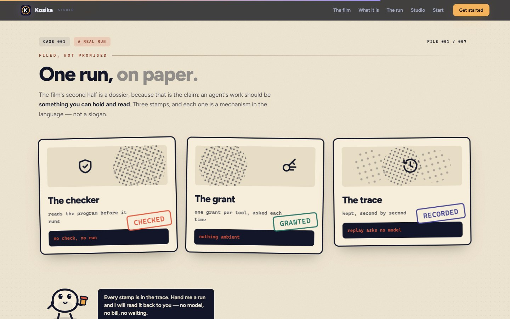
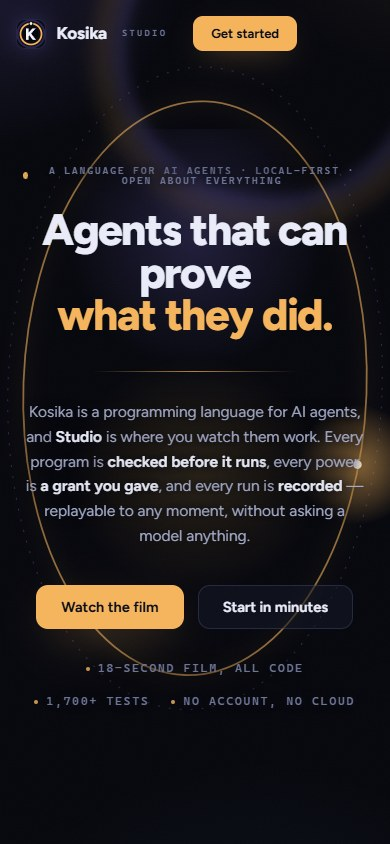

<p align="center">
  
</p>

<p align="center">
  <b>Agents that can prove what they did.</b><br>
  A language for AI agents: checked before it runs, granted tool by tool,
  recorded second by second — and replayed without asking a model anything.
</p>

<p align="center">
  <a href="https://blackhole8080-darkmatter.github.io/kosika/"><b>Website</b></a> ·
  <a href="site/film/index.html">The film</a> ·
  <a href="GETTING_STARTED.md">Getting started</a> ·
  <a href="TUTORIAL.md">Tutorial</a> ·
  <a href="KOSIKA.md">Language contract</a>
</p>

An early prototype (earlier codename: Synapse). Not ready to depend on — see
[Status](#status-a-prototype-not-a-released-language).

## Start here

```text
python -m pip install .
kosika new hello && cd hello          # a complete agent, with its own tests
kosika run main.kos --input input.json --model-fixture responses.json
kosika replay run_trace.jsonl         # no model, no bill, the same answer
kosika studio . --model qwen2.5:7b    # watch a run, then read what it did
```

A run needs the model *granted*: `--model` names one, `--model-fixture` answers
from a file. [GETTING_STARTED.md](GETTING_STARTED.md) is the fifteen-minute
version; [TUTORIAL.md](TUTORIAL.md) ends with a run you can replay.

## What the language enforces

Three claims, and the checker is what makes them true.

**Checked before it runs.** A model's answer is accepted only if it is a
complete record of the type you declared. A program that does not check does
not run.

```kosika
record Question { text: Text }
record Answer { text: Text confidence: Number }
model writer { input: Question output: Answer }

workflow answer(question: Question) -> Answer {
  step respond {
    let result: Answer = use_model writer(text: question.text)
    return result
  }
}
```

**Granted, tool by tool.** Commands and file access happen only through a
declared `system` tool, and only when you grant and approve it. Declaring a
model grants no network — that is `--model`.

```kosika
tool save_note {
  source system "files"
  operation: "write"
  access: execute
  input: FileWrite
  output: FileWritten
}
```

`--approve` stops before each such call, shows the tool and its arguments, and
asks `Approve this one action? [y/N]`. Anything but yes skips that call; with no
terminal to ask in, the run pauses.

**Recorded, run by run.** Every step, answer, and the exact words sent to the
model are in the trace. Replay validates it and returns the same result without
a model, so a bug report can carry its own reproduction.

```text
kosika run main.kos --trace run.jsonl
kosika replay run.jsonl
```

## Evidence, and its limits

`kosika compare-python` runs six tasks written three ways — Kosika, plain
Python, and Python that also rejects wrongly shaped data. All three return the
same answers:

| | Kosika | Python, plain | Python, checked |
| --- | --- | --- | --- |
| Lines of code, all six tasks | 84 | 81 | 108, plus 35 shared helper lines |
| Lines, four data tasks | 50 | 38 | 47 |
| Lines, two model tasks | 34 | 43 | 61 |
| Tokens, all six tasks | 817 | 633 | 899, plus 286 in helpers |
| Bad-data cases refused, of 20 | 20 | 9 | 20 |

Kosika is about the size of plain Python and heavier in tokens, mostly for record
declarations. The advantage is not size: it refused every bad case, where plain
Python accepted 11 of 20. Those cases were chosen by the author, so read that
row as "what Kosika checks for free", not an error rate. Details in
[KOSIKA_PLAN.md](KOSIKA_PLAN.md).

`benchmarks/researcher` asks forty questions about a folder of notes, nothing
scripted. Last run: `qwen2.5:7b` was right 39 of 40 with no false answer;
`qwen2.5:1.5b` was right 32 times with 8 false answers. Its README has the
tables and what the numbers do not show.

```text
python benchmarks/researcher/run.py --model qwen2.5:7b --embed-model nomic-embed-text
```

`spec-eval` asks whether a model can write Kosika from
[AGENT_GUIDE.md](AGENT_GUIDE.md) alone: 20 specs, each judged by the checker, its
required declarations and an exact fixture-backed result.

```text
kosika spec-eval
kosika spec-eval --solver model --base-url URL --model NAME
```

## Studio

```text
kosika studio FOLDER --model MODEL --allow-folder FOLDER
```

It opens its own window and shows every agent under `FOLDER`. During a run each
step lights up; afterwards you read what it did in plain words, what went to the
model and came back, what it remembers, the agent's map, and the code with the
checker's first problem under it.



Studio does only what its command allowed: it listens on 127.0.0.1, requires a
token on every request, and without `--model` it shows and tests but runs
nothing. A recording replays at one, two or four times speed.

## Use it from an AI assistant

`kosika-mcp` is a Model Context Protocol server: an assistant can read the guide,
then write, check, run, replay and map Kosika programs itself.

| Tool | What it does |
| --- | --- |
| `kosika_guide` | Returns `AGENT_GUIDE.md` |
| `kosika_check` | Checks a program; returns codes, messages and lines |
| `kosika_run` | Runs a workflow with the inputs and scripted answers supplied |
| `kosika_replay` | Validates a trace from `kosika_run` and returns its result |
| `kosika_map` | Describes what a checked program declares |

```text
claude mcp add kosika -- kosika-mcp
```

No power of its own: programs arrive as text and are checked in a temporary
folder, no tool takes a file path, address or command, and `kosika_run` never
calls a real model or tool.

## The website

Live at <https://blackhole8080-darkmatter.github.io/kosika/>. [`site/`](site/) is
one HTML file — no build, no dependencies, no network — with an 18-second film, a
recorded run replayed by the reader's scroll, and a stamped case file.

| | |
| --- | --- |
|  |  |
| **The hero.** The headline rises, an orbit draws itself, and the film's run moves behind it. | **The film.** *One Run, On Paper* — 18 seconds, drawn frame by frame as a function of time. |
|  |  |
| **The run.** A real recording replayed by scroll. | **The paper file.** The film's second half as a dossier, stamped. |
|  |  |
| **Studio.** Every run is a file you can open and replay. | **On a phone.** The same page, one column. |

Source is in [`site/film/`](site/film/), the encoder is
`site/film/render.mjs`, and [`site/README.md`](site/README.md) covers rendering,
publishing and the tools that regenerate the logo and screenshots. More Studio
shots are in [`site/shots/`](site/shots/).

## Status: a prototype, not a released language

Version `0.1.0`, API unstable, published so the design can be reviewed and
argued with.

- **Works today.** A parser, checker and runtime; typed records, functions,
  bounded loops, modules and workflows; declared models, bounded agents, tools
  and capabilities; approval-gated execution; deterministic mindmaps; structured
  diagnostics; an LSP backend; installable `kosika` and `kosika-lsp` commands; a
  local `.kos` workbench; offline replay of recorded traces.
- **Incomplete.** A demonstrated live-model setup, published releases and remote
  delivery, swarm messaging and consensus, component sandboxing,
  expression-precise checker spans, and the full author/check/repair/run loop.
  Some features are declared or exposed as host experiments without being
  integrated end to end.
- **[KOSIKA_VISION.md](KOSIKA_VISION.md) is a design target, not a description of
  this codebase** — tensors, memory bubbles, personality policies, an extension
  ecosystem, consensus. Most of it is not built.

If you are evaluating Kosika for real use, it is not there yet. If you are
evaluating the *idea* — authority, evidence and replayability enforced by the
language, not convention — read on.

## Where the detail lives

| Read | For |
| --- | --- |
| **[docs/LANGUAGE_DETAIL.md](docs/LANGUAGE_DETAIL.md)** | Every feature in full: thinking steps, planning agents, skills, sessions, vectors and graphs, parallel steps, the Python SDK, environments, manifests, the MCP adapter, swarms, mindmaps |
| [GETTING_STARTED.md](GETTING_STARTED.md) | Install and a first agent in fifteen minutes |
| [TUTORIAL.md](TUTORIAL.md) | Nothing to a running, replayable model workflow |
| [KOSIKA.md](KOSIKA.md) | The versioned contract: grammar, typing, execution, capabilities, replay |
| [AGENT_GUIDE.md](AGENT_GUIDE.md) | The language guide written for AI authors |
| [DEVELOPMENT.md](DEVELOPMENT.md) | Examples, APIs, security boundaries, limitations |
| [KOSIKA_PLAN.md](KOSIKA_PLAN.md) | Capability matrix, verification record, backlog |
| [KOSIKA_VISION.md](KOSIKA_VISION.md) | The long-term target — argued for, not claimed |

## Repository

| Path | What it holds |
| --- | --- |
| `kosika/` | The language: lexer, parser, checker, runtime, and tools |
| `kosika_lsp/`, `editors/` | Editor support (language server, VS Code extension) |
| `examples/`, `benchmarks/`, `tests/` | Example programs, the spec benchmark, the test suite |
| `site/` | The website: one HTML page, the film's source, renderer, screenshots |
| `network/`, `ui/`, `hive/`, `archive/` | Manifests, UI styles, agent notes, historical documents |
