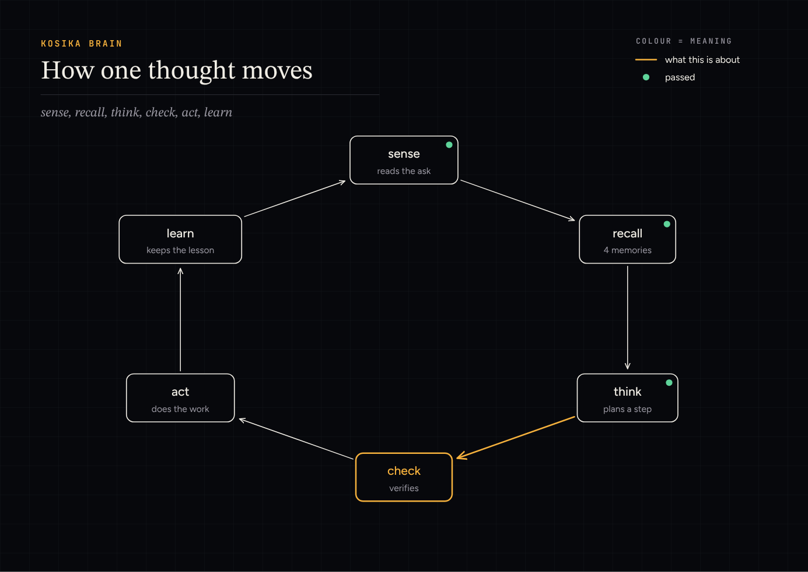
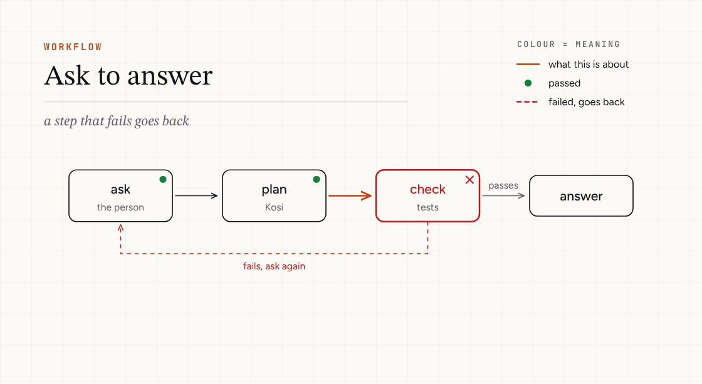
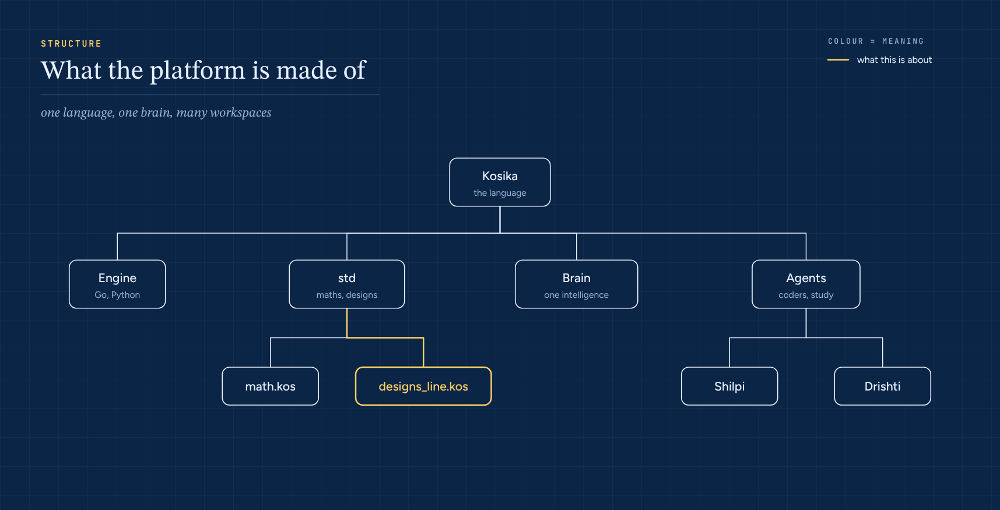
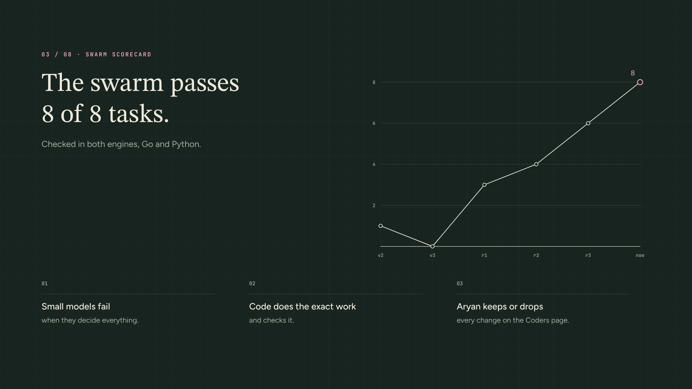

# Kosika Designs: the line style

When a Kosika agent explains something on the canvas (a workflow, how a
system is built, a slide in a deck), it draws in thin lines. This is the same
look as Kosika's white-line maths drawings. The code is in
`std/designs_line.kos`, and it uses no model: the layout is arithmetic done
by Kosika.

| Look | Ground | Lines | Accent | Used for |
|---|---|---|---|---|
| `white` | `#07080c` | `#f1eee6` | amber `#f5b13d` | the dark theme (default) |
| `black` | `#fbfaf7` | `#111216` | rust `#c2410c` | the light theme |
| `blueprint` | `#0b2547` | `#e8f1ff` | yellow `#ffd166` | builds, systems |
| `chalk` | `#18241f` | `#efeadb` | pink `#f4a7b9` | study notes, teaching |

Every look is checked for contrast with Kosika Designs' own arithmetic:
lines at least 7:1 on the ground, quiet words 4.5:1, and colours 3:1.

## The colour rule

An agent never chooses a colour. It says what things mean, and the file
turns meaning into colour:

- Everything is drawn in the line colour, and quiet words in the dim colour.
- The **focus** is the one node the picture is about, or where the work is
  now. It gets the accent, and so does the line into it. There is at most
  one focus.
- A step that **passed** gets a small green dot. A step that **failed** is
  red, and its way back is a red dashed line. These appear only when there
  is a real result.
- Anything else, such as a way back that is not a failure or the untaken way
  on from a failed step, is quiet.
- The key in the corner lists only the meanings the picture uses.

`ln_rule(figure)` says in plain words what breaks the rule: an unknown
focus, a state other than `ok` or `bad`, a line to a node that does not
exist, or the same id used twice.

## Shapes

- `flow`: steps left to right, five to a row. Give the edges, or each step
  leads to the next. Back edges run dashed underneath.
- `loop`: a cycle around an oval, with the first step at the top.
- `tree`: parts by parent. Each part sits under its parent, with a share of
  the width set by how many leaves hang under it.
- Slides: `LnSlide` holds a claim, an optional quiet line chart (only the
  latest point wears the accent) and up to three short points.

## In Kosika Designs

The Designs front door (`design`) draws a diagram in the line style when the
ask says so ("in white lines", "as a blueprint", "on a chalkboard", "line
style"), or when the palette is `white`, `black`, `blueprint`, `chalk` or
`line`. `line` follows the theme. The structure the model described becomes
a line figure: parts with parents become a tree, a cycle, orbit or hub
becomes a loop, and anything else becomes a flow.
