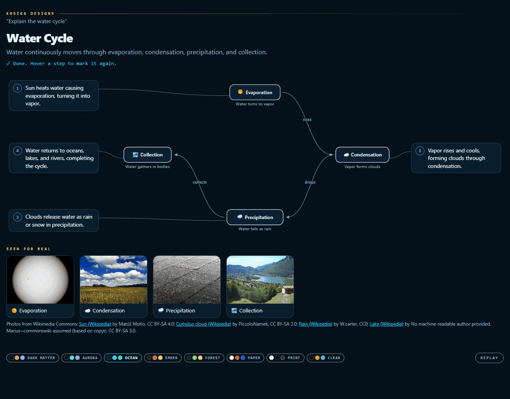
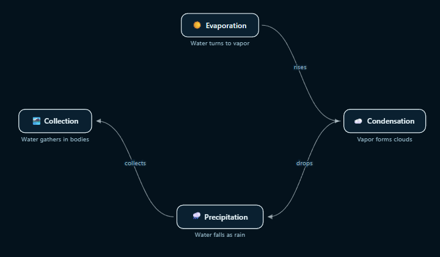
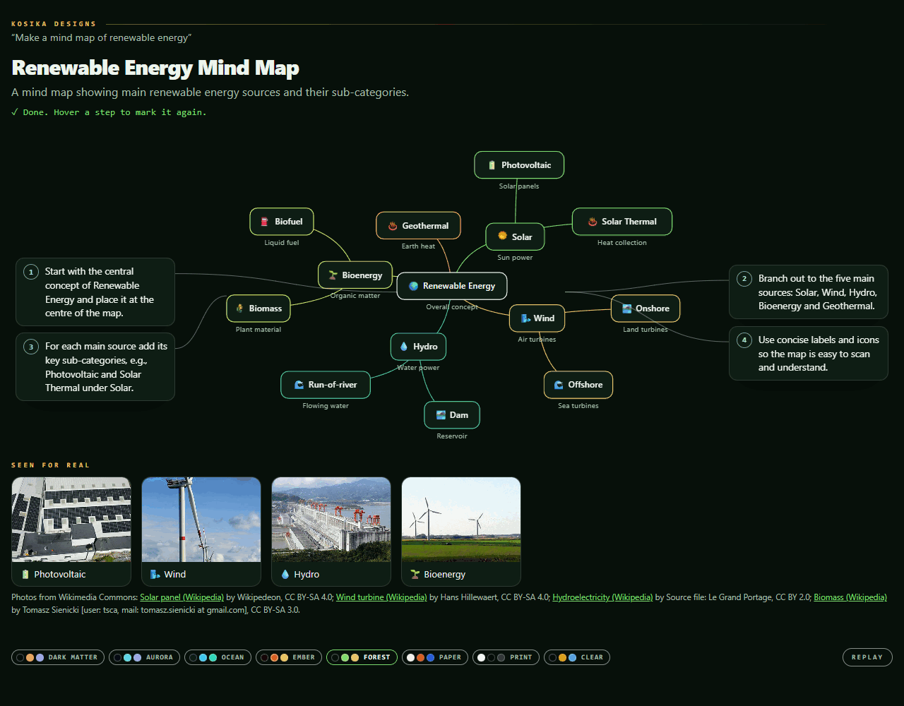
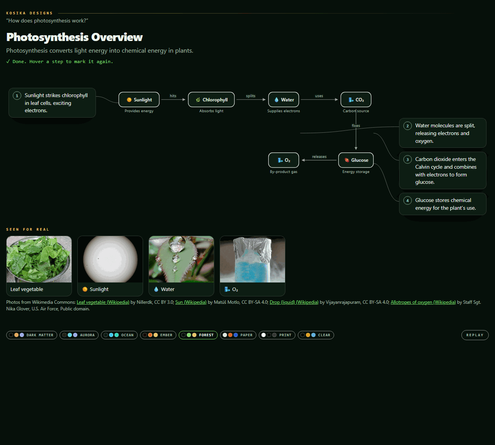
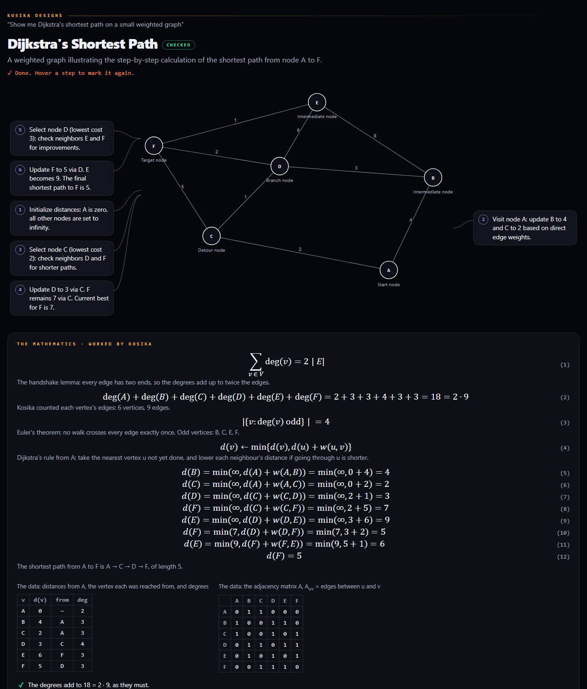
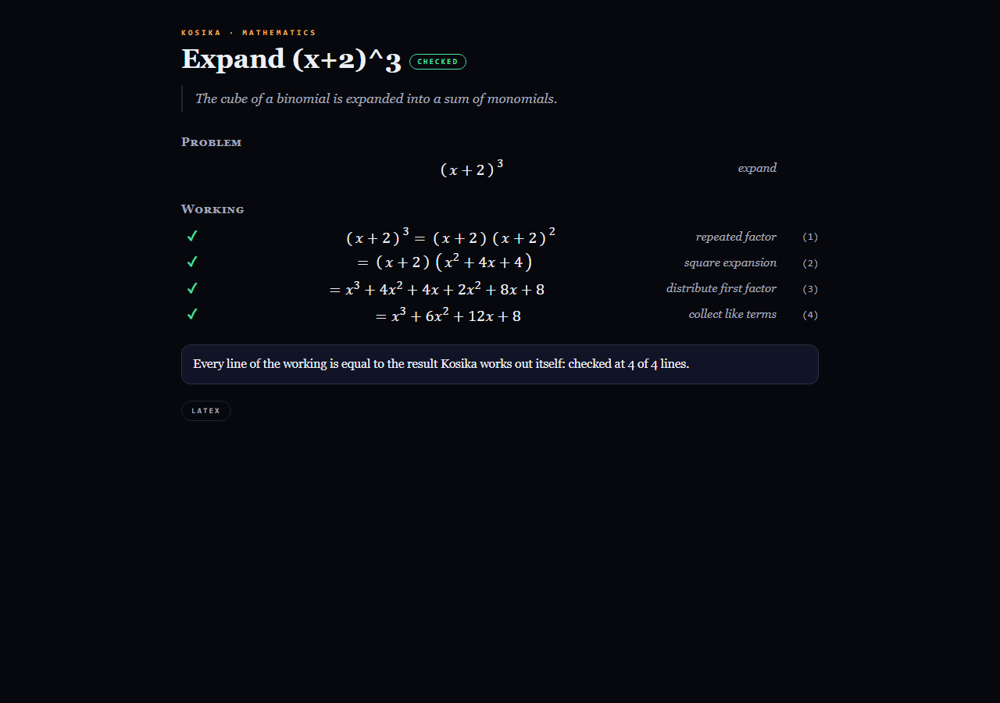
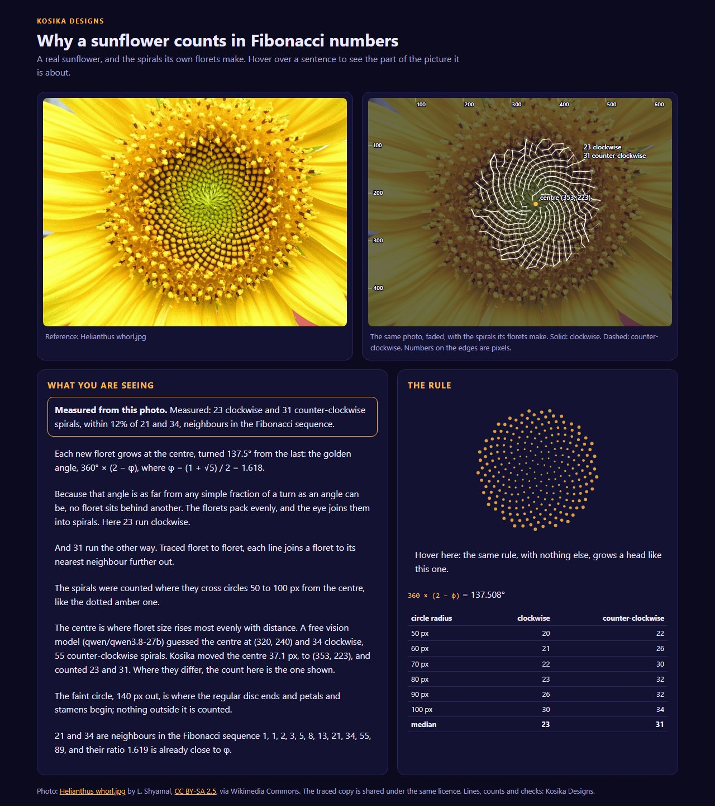
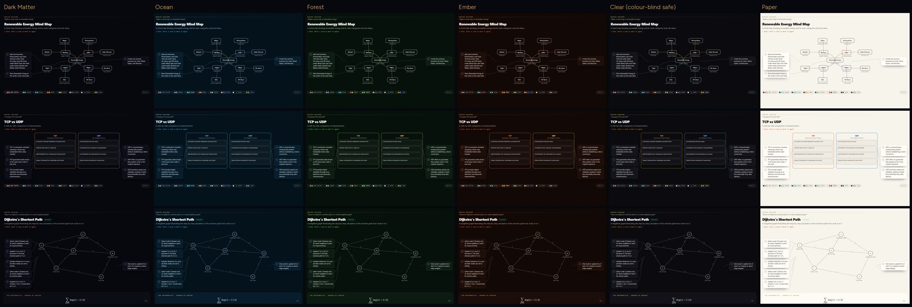

# Kosika Designs

You ask a question and get back a drawing that explains it. The explanation
is written into the drawing, one step at a time. Hover over a step and the
part it talks about lights up. Kosika checks the drawing's mathematics and
corrects it, and it shows real photos only where they help.

Kosika Designs runs on free and open models only, through Groq and
OpenRouter. Its photos are freely licensed, and each one is credited on the
page.

## What it draws

### A cycle, with icons inside its boxes

Each box gets an emoji that moves the way its thing does. The sun turns, a
cloud drifts and rain drips. When a step is marked, its icon moves faster.

### A mind map

### A flow, and when Kosika shows no photo

Kosika decides when a photo helps. It shows at most four. Some parts never
get a photo:

- graphs, comparisons, timelines and figures of mathematics
- chemicals, gases, energy and particles, which no camera can show
- any part where the matching Wikipedia article's own picture is a drawing
  or is missing

For example, oxygen and glucose get an icon here and no photo.

### A graph, with its mathematics worked and checked

Kosika works the shortest path itself, one line at a time. It also checks
the handshake lemma and Euler's theorem, and shows the distance table and
the adjacency matrix. If the model's explanation gets a number wrong,
Kosika writes the correction next to it.

### Mathematics written as a paper

The model writes the working. Kosika checks every line against its own
result (`std/math.kos`) and corrects any line that is wrong. The page can
be exported as LaTeX.

### A real photo, measured

Kosika traces the sunflower's spirals on a real photo and counts them. A
count is called Fibonacci only when it is close to Fibonacci numbers.

### Palettes

There are eight palettes. Dark Matter is the default, and Clear is safe for
colour-blind readers (Okabe–Ito). Kosika checks every palette's contrast
against WCAG before using it (`palette.kos`).

## The files

| File | What it does |
| --- | --- |
| `main.kos` | Reads the question, plans the drawing and describes it |
| `draw.kos` | Lays out and draws every kind of drawing, checks it, and writes the page |
| `palette.kos` | Holds the palettes and checks their contrast |
| `paper.kos` | Writes mathematics as a paper and checks each line |
| `sunflower.kos` | Traces and measures a real sunflower photo |
| `eyes.py` | Finds freely licensed photos on Wikipedia and Wikimedia Commons |

Kosika AI Chat (`examples/apps/chat`) shows these drawings as its answers.

Photos in the screenshots are from Wikimedia Commons, under the licences
credited on each page.
