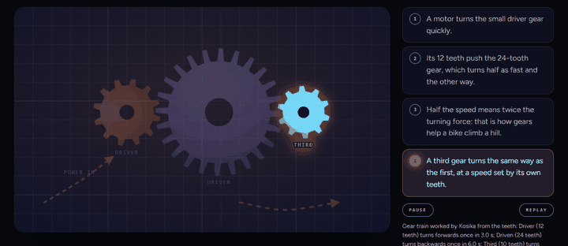
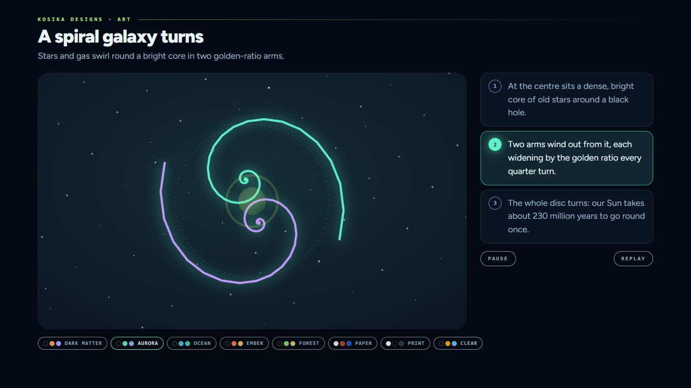
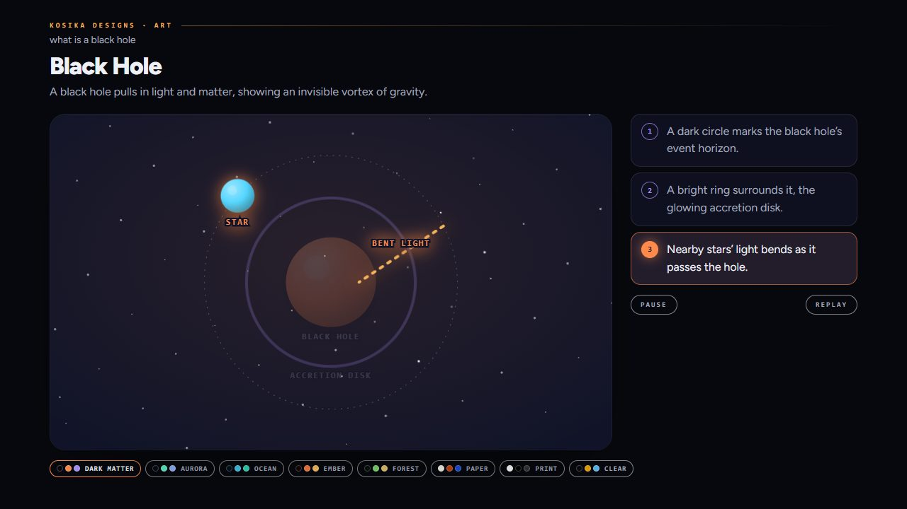
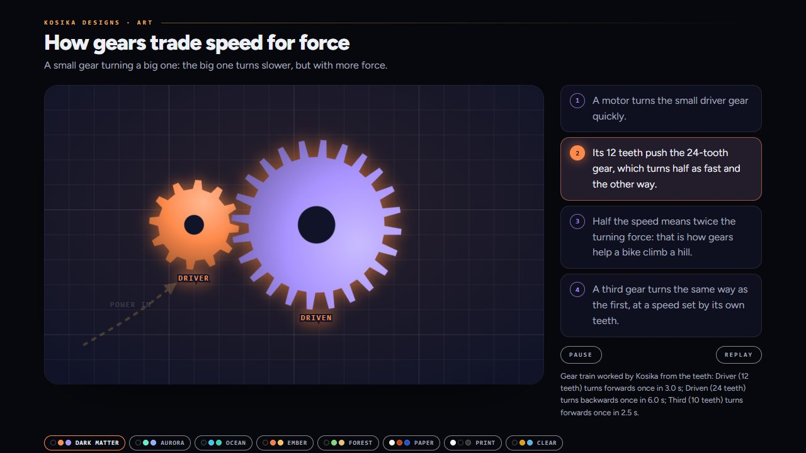
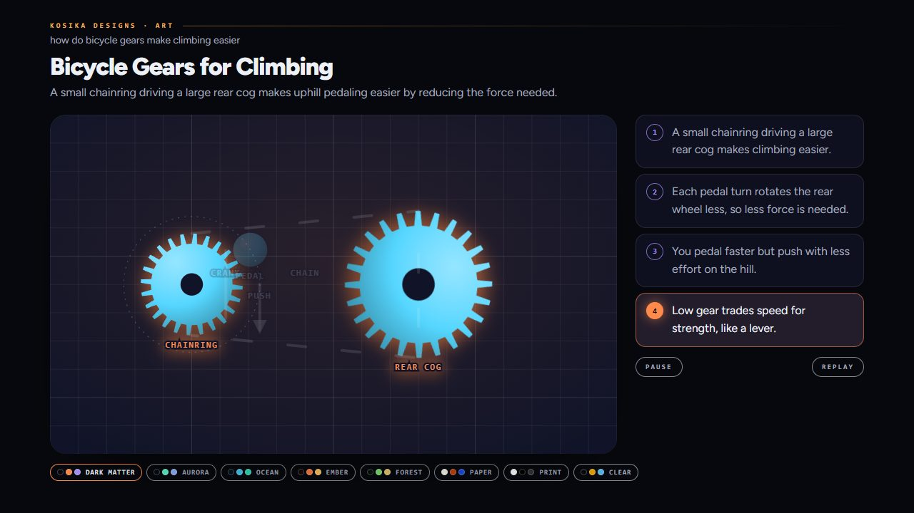

# Kosika Art

Small, calm, animated illustrations that sit beside an explanation.



A model says **what** is in the picture: a few flat figures on a grid
100 wide and 60 tall, how each one moves, a backdrop, and three to five
short sentences that each name the figures they are about. It sends this
as data, never as drawing code.

Kosika ([`../art.kos`](../art.kos)) decides **how** it looks:

- It checks every figure, motion and sentence, and sends any mistakes back
  to the model once, each one named.
- It fixes small slips itself and says what it changed. A shape that is
  slightly too big gets smaller. A name with no room under its figure
  moves above it. A line given only `x, y, w, h` is drawn from those.
- It works out the geometry: sun rays, waves from the sine, polygons and
  stars, gear teeth, and golden spirals that grow by φ every quarter
  turn.
- It works out the motion. Orbits round the same body are timed by
  Kepler's third law. Gears whose teeth touch turn each other the other
  way, at the ratio of their teeth.
- It draws the picture in one of the checked palettes (`../palette.kos`),
  with soft light and shade and a backdrop (night, sky, sea, land, grid).
  The night's stars are spread evenly by the R2 sequence.

On the page, each figure appears as its sentence plays, lit while the
rest dims, and then the whole scene loops. Hover a sentence to hold it,
or click a figure to jump to its sentence.

| | |
|---|---|
|  |  |
| Hand-made: two golden-spiral arms | From the prompt "what is a black hole" |
|  |  |
| Hand-made: a three-gear train | From the prompt "how do bicycle gears make climbing easier" |

## Run it

Draw one of the samples here, with no model:

```
kosika run ../art.kos --workflow render --input planets.json
```

Draw from a prompt with a free model:

```
kosika run ../art.kos --workflow illustrate --input ask.json \
    --model openai/gpt-oss-120b --model-url https://api.groq.com/openai/v1 \
    --model-protocol openai --max-output-tokens 8000
```

Here `ask.json` is `{"ask": {"text": "why do bees build hexagons", "palette": ""}}`.
Leave `palette` empty to let the model choose, or name a palette to match
a page.

The result is an `ArtPage` with these fields:

- `page`: a whole page.
- `svg`: the picture alone, which follows its page's `html[data-palette]`.
- `problems`: anything that stopped the drawing.
- `fixed`: what Kosika changed itself.

To put the picture in another page, such as the chat canvas, use `svg`
together with `art_style()` and `art_script()`.

## Samples

`planets`, `water`, `circuit`, `leaf`, `gears` and `galaxy` were made by
hand to set the bar. With a free model through the virtual router, 7 of
8 test prompts were drawn in 2 to 5 seconds. Layout is still where the
model is weakest, and the heart and the rainbow come out too abstract.
