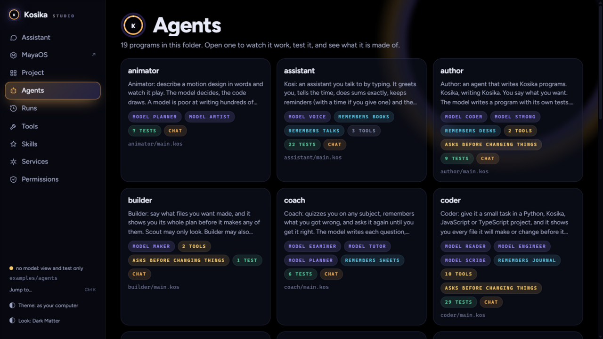
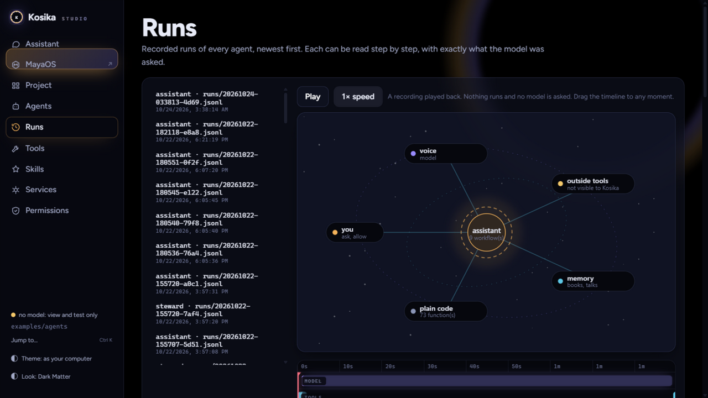

# The Kosika website

One self-contained page that tells what Kosika and Kosika Studio are: a
language for agents whose programs are checked before they run, granted
power by power, and recorded run by run.

- `index.html` — the whole site. No build step, no dependencies, no
  network calls. The typeface (Figtree, SIL Open Font License — see
  `fonts/Figtree-OFL.txt`) is served from the same folder.
- `shots/` — screenshots of Kosika Studio in its Dark Matter look.

## The film in the middle

The page's centrepiece is a recorded run of a real agent, replayed by the
reader's scroll: the diagram lights up step by step, the timeline scrubs,
the clock ticks. The run is baked into the page as static data (`const
STORY` in `index.html`), so the page needs no server — and replay asks no
model, which is exactly the point it makes.

To bake in a different run, replace the `STORY` value with the JSON that
a running Studio returns from `/api/story?id=<agent>&trace=<trace>`.

## Serving it

Any static file server will do:

    python -m http.server 8090 --directory site

To publish on GitHub Pages, serve this folder as the site root (Settings →
Pages → deploy from a branch that contains `site/`, with `/site` as the
path), or copy the contents of `site/` to where your Pages branch serves
from. The page is one file plus its fonts; nothing else is needed.

## Screenshots

| Studio's agent gallery | A recorded run, on the timeline |
| --- | --- |
|  |  |

Every colour on both the site and Studio comes from one token set — the
site re-grades itself with the same Dark Matter identity the app wears.
