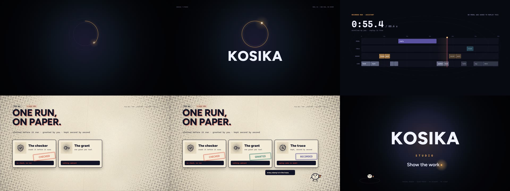

<p align="center">
  
</p>

# The Kosika website

**Live at <https://blackhole8080-darkmatter.github.io/kosika/>** — served by
GitHub Pages from this folder, on every push that touches it.

One self-contained page that says what Kosika and Kosika Studio are: a
language for agents whose programs are checked before they run, granted power
by power, and recorded run by run — and a Studio where you can read and replay
what happened without asking a model anything.


- `index.html` — the whole page. No build step, no dependencies, no network
  calls. The typeface (Figtree, SIL Open Font License — see
  `fonts/Figtree-OFL.txt`) is served from the same folder.
- `assets/site.css`, `assets/site.js` — the two worlds (ink screen, cream
  paper) and the motion.
- `assets/mark.svg` — the mark: a gold ring, a dot resting on it, and K from
  Figtree's own outline, so it needs no font to render. It is also the
  favicon.
- `media/` — the film, its poster, and the logo.

## What is on the page

| Section | What it does |
| --- | --- |
| The hero | The headline rises letter by letter while an orbit draws itself and a dot travels it. Behind it, the film's own run moves — silent, soft, four seconds mirrored. The floating chips are the language's words. |
| The film | *One Run, On Paper*, 18 seconds, with sound. |
| What it is | Four claims: checked, granted, recorded, replayable. |
| The run | A real recorded run, replayed by your scroll: the diagram lights up, the timeline scrubs, the clock ticks. |
| Studio | The window it was recorded in, with a recorded run inside it. |
| The paper file | The film's second half as a dossier — three stamped exhibits and Kosi, the clerk. |
| Start | Three commands, and the honest FAQ. |


## The loop in the hero

The hero plays the film itself, not a second animation: a two-second slice of the
running timeline (5.15s–7.15s), cropped past the recording's clock, soft-focused
and masked, at 30% over the ink. It is mirrored into a four-second loop, so the
clips fill the lanes and then empty them — no cut, no jump back.

```text
# 1. the slice, from the composition
node film/render.mjs --from 5.15 --to 7.15 --fps 30 --crf 24 --out /tmp/hero-run.mp4

# 2. crop the clock out, mirror it into a loop
ffmpeg -i /tmp/hero-run.mp4 -filter_complex \
  "[0:v]crop=1380:520:530:295,scale=1280:482,split[a][b];[b]reverse[r];[a][r]concat=n=2:v=1[o]" \
  -map "[o]" -c:v libx264 -preset slow -crf 24 -pix_fmt yuv420p -movflags +faststart -an \
  media/kosika-hero-loop.mp4
```

140 KB, no audio track at all. It pauses when the hero leaves the viewport, is
hidden under `prefers-reduced-motion`, and is not served to phones at all.

## The film in the middle

**One Run, On Paper** is the page's centrepiece and it is code. One HTML file
draws every frame from a single number: at time `t`, the same canvas is
produced on your screen as in the encoder. There is no footage and no video
model.

- `film/index.html` — the composition. `render(t)` is the whole film; open it
  with `?t=11.9` to see one frame, or `?play` to watch it loop.
- `film/render.mjs` — the renderer: a headless browser seeks the page frame
  by frame, crops the canvas, averages 180°-shutter subframes in place, and
  pipes them to ffmpeg.
- `film/score.py` — the score, synthesised from the same timeline: one room,
  a low bed, three paper thuds, one bell.

The beats:

| Time | On screen | What carries over |
| --- | --- | --- |
| 0.00 | a resting dot in the dark | the dot |
| 1.00 | the dot draws its own orbit | the ring is an iris |
| 4.60 | the run: lanes, playhead, clips | the playhead is the dot |
| 7.20 | halftone dot wipe | the playhead's dot seeds the wipe |
| 7.35 | a case file: three exhibits, stamped | the paper |
| 13.40 | pull back: one file of many | the desk is paper too |
| 15.30 | the wordmark, and the period | the period is the dot |



Rendering it again:

```text
node tools/serve.mjs 8099
node film/render.mjs --out ../media/kosika-film.mp4 --fps 30 --workers 4
node film/render.mjs --stills 2.4,11.9,17.2 --out ../media/stills/
```

540 frames take about a minute. The score is synthesised by `film/score.py`
from the same timeline and muxed with ffmpeg (`-c:v copy`, AAC), so picture
and sound stay in step by construction.

## Serving it

```text
node tools/serve.mjs 8099          # http://127.0.0.1:8099/
```

`tools/serve.mjs` is dependency-free and supports byte ranges, which matters:
the reel is a real `<video>`, and seeking it needs `206 Partial Content`.
`python -m http.server` does not send that, so the film plays but cannot be
scrubbed. Any static host (GitHub Pages included) is fine.

To publish on GitHub Pages, serve this folder as the site root — the workflow
in `.github/workflows/pages.yml` already uploads `site/` on every push that
touches it.

## Rebuilding the pictures

```text
node tools/capture-shots.mjs       # shots/site-*.jpg, 1440×900 and 390×844
node tools/make-logo.mjs           # media/kosika-logo.png, media/kosika-mark.png
node tools/logo.html               # the logo lockup, as a page
```

Both need `puppeteer-core` and a Chrome install (`CHROME_PATH` overrides the
default). The screenshots are taken from the live page and park the reel on a
frame worth photographing, so they always match the code.

## Notes

- The page needs no server: the recorded run is baked in as static data
  (`const STORY`), and replay asks no model — which is exactly the point it
  makes. To bake in a different run, replace `STORY` with the JSON a running
  Studio returns from `/api/story?id=<agent>&trace=<trace>`.
- Motion is written for people who want to see it: the hero's first paint is
  synchronous, the headline and counters have timer fallbacks, and everything
  has a `prefers-reduced-motion` resting state (and a `<noscript>` one).
- Every colour on the page and in Studio comes from one token set, so the site
  re-grades itself with the same Dark Matter identity the app wears.
- `node tools/check.mjs` walks the page at 1440 and 390, and asserts what the
  last review verified by hand: no overflow, no console errors, every image
  decoded, the paper section clear of the wipe canvas, the run scrubbing, the
  reel seeking, and the floating chips gone on a phone.
